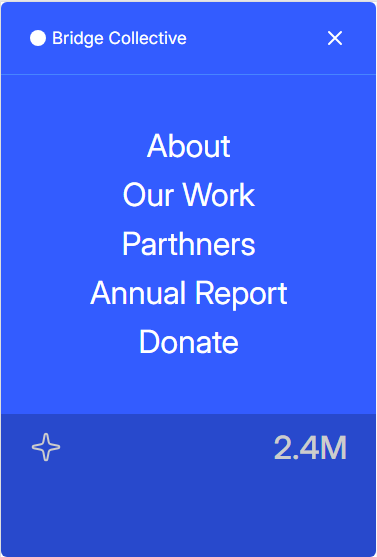
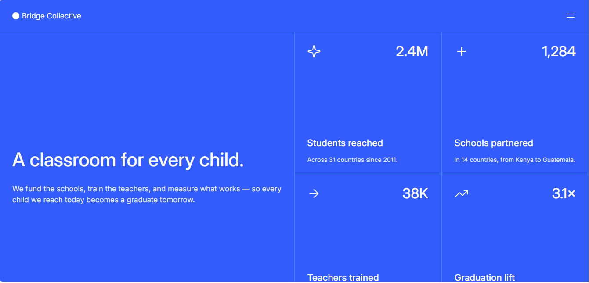

# Frontend Mentor - Grid landing page solution

This is a solution to the [Grid landing page challenge on Frontend Mentor](https://www.frontendmentor.io/challenges/grid-landing-page). 

## Table of contents

- [Overview](#overview)
  - [Screenshot](#screenshot)
  - [Links](#links)
- [My process](#my-process)
  - [Built with](#built-with)
  - [AI Collaboration](#ai-collaboration)
- [Author](#author)

## Overview

### Screenshot

<!--  -->

<!--  -->

### Links

- Solution URL: [GitHub Repository](https://github.com/vrroel/grid_landing_page)
- Live Site URL: [GitHub pages](https://vrroel.github.io/grid_landing_page/)

### Built with

- Semantic HTML5 markup
- CSS custom properties
- Flexbox
- CSS Grid
- Mobile-first workflow
- JavaScript for the menu.

### AI Collaboration

I just used Google's AI mode to look up some CSS properties. 

## Author

- GitHub Profile - [Alexis V.](https://github.com/vrroel)
- Frontend Mentor - [@vrroel](https://www.frontendmentor.io/profile/vrroel)
- Telegram - [@verroele](https://t.me/verroele)

